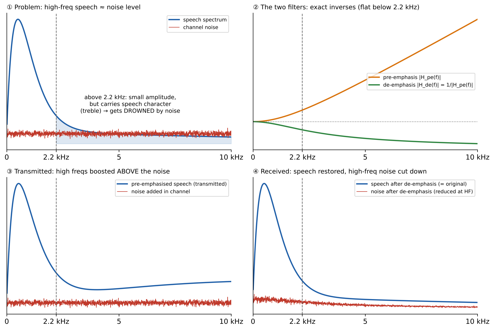

# Core Elements: Test Notes

## 1 Headings and inline text

**Objective:** check every core mapping in one file.

**Pulse Code Modulation (PCM)** turns samples into codes. This is **not** optional, and the signal `data_out` leaves the module.

A run-in line with *italic* text and a hard
line break inside the paragraph.

### 1.1 Lists:

- First item
  - Nested item
    - Third level
- Second item

1. Step one
2. Step two

#### Deepest heading

Text under a level-four heading.

## 2 Tables

| ID | Module | Description |
|---|---|---|
| M01 | Control Unit | Manages instruction sequencing, state transitions, and coordination between datapath components during execution. |
| M02 | Concatenation / Replication | Builds wider vectors from smaller pieces. |

| Quantity | Formula | Symbols |
|---|---|---|
| Noise power | $\overline{q^2} = \dfrac{\Delta v^2}{12}$ | $\Delta v$ = step size<br>$q$ = error |
| SQNR | $\text{SQNR} = 6.02n + 1.76$ dB | $n$ = bits |

## 3 Equations

$$f = \frac{1}{T}$$

where:

- $f$ is frequency in Hz
- $T$ is the period in seconds

$$\overline{q^2} = \frac{1}{\Delta v}\int_{-\Delta v/2}^{\Delta v/2} q^2\,dq$$
$$= \frac{\Delta v^2}{12}$$

$$\boxed{B_{PM} = 2(\Delta f + B)}$$

*Write also:* for FM, $\Delta f = k_f m_p/2\pi$; PM bandwidth grows with message frequency.

## 4 Code

```bash
make synth TOP=kronos_core
```

```
project/
+-- src/
|   +-- top.v
+-- tb/
```

```json
{"design": "picorv32", "clock": 10}
```

## 5 Figures



**Purpose:** shows where each filter sits.


## 6 Unicode and links

Bandwidth ≈ 2(β + 1)B, with β ≥ 0 and θ ≤ π. Signal ⇒ noise, ✔ done, ✘ wrong, ⚠ careful, ★ key.
Values: 10⁻⁶ s, x₁, ½ and 25 °C.

See [the tables section](#2-tables) and the [derivation sheet](3-derivation-sheet.md#d1-bandwidth-of-pm).
